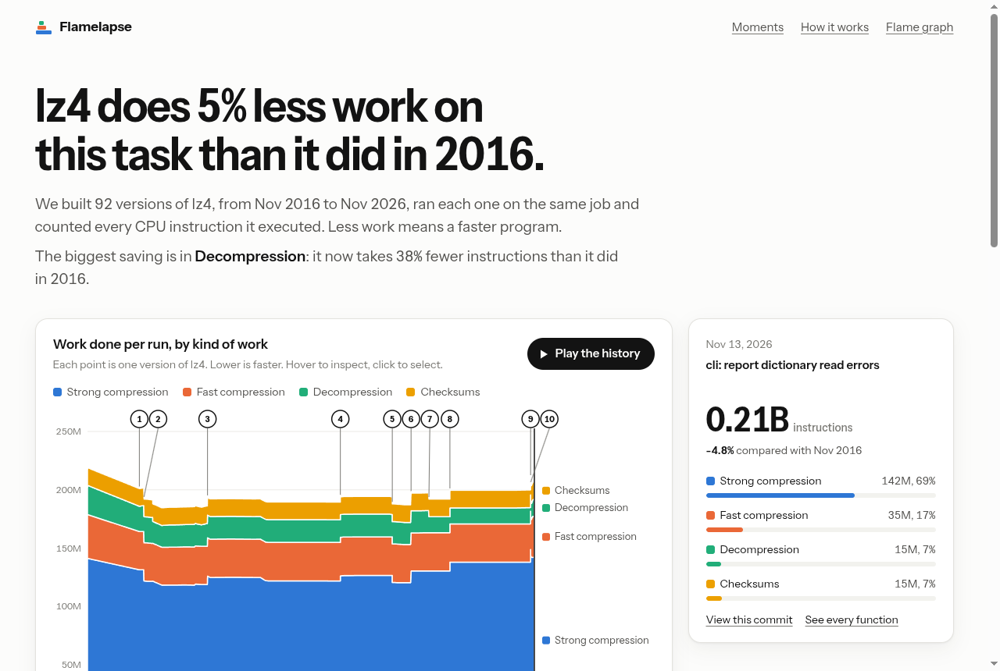

# Flamelapse

See how a program's speed changed across its whole git history, with every big jump pinned to the commit that caused it.



## Install

```
pipx install git+https://github.com/Ar-maan05/flamelapse
```

Needs Linux, git, Python 3.11+ and valgrind. Run `flamelapse doctor` to check. On macOS or Windows, use [Docker](#docker).

## Use

```
flamelapse quick https://github.com/lz4/lz4 --since v1.9.0 --run "{bin} -1 -c big.bin"
```

That clones the project, works out how to build it, builds a few dozen versions, measures each one running your command, and opens the report.

In `--run`, `{bin}` is the program built from each version. Pick a job that takes well under a second, since every version runs it under Valgrind (about 50x slower). Input files like `big.bin` can sit in the folder you run it from.

Step by step instead:

```
flamelapse init <repo> --run "<command>"   # writes flamelapse.toml and checks the build and the command
flamelapse run                             # build, measure, report; safe to stop and resume
flamelapse open
```

## Docker

```
docker build -t flamelapse https://github.com/Ar-maan05/flamelapse.git
docker run --rm -it -v "$PWD":/work flamelapse quick https://github.com/lz4/lz4 --since v1.9.0 --run "{bin} -1 -c big.bin"
```

The report lands in `./lz4/flamelapse-report/`. Open `index.html` from there.

## Good to know

- It counts CPU instructions, not seconds. That makes results repeatable to about 0.02%, but a change that gets faster by running things in parallel can show up as more work.
- It works for programs compiled to native code (C, C++, Rust and so on) that run as one command and exit. It is not useful for interpreted languages, servers or GUIs.
- Old versions that no longer build are skipped, and the run ends with a list of reasons. After fixing one, `flamelapse run --retry` tries them again.
- The [guide](docs/guide.md) covers the config file, choosing a workload and how it all works. `examples/` has ready configs for jq and lz4.

## License

MIT
